# Çalışanlar Neden Ayrılmayı Düşünür? – 2024 ABD Federal Çalışan Anketi (FEVS) Analizi


> 📄 **Akademik formatta özet rapor:** [docs/ARASTIRMA_RAPORU.md](docs/ARASTIRMA_RAPORU.md)

<details>
<summary><b>English abstract</b></summary>

Using 674,207 responses from the U.S. Office of Personnel Management's 2024 Federal Employee Viewpoint Survey (FEVS), this project models federal employees' intention to leave their agency within a year. All estimates are weighted with OPM post-stratification weights. After removing target-synonymous satisfaction items and running an automated leakage screen, four models were compared under an equal tuning budget against two baselines; the held-out test set was used exactly once. The selected HistGradientBoosting model reaches a test ROC-AUC of **0.791** (95% CI 0.788–0.794) versus 0.695 for a single-item rule, and is well calibrated. SHAP and permutation importance agree that **organizational attachment (Q88), inspiring work (Q86), pay satisfaction (Q71) and use of talents (Q6)** are the strongest drivers; pay acts as an independent factor, and is the top driver for employees under 40. Demographic differences are statistically significant but small (Cramér's V < 0.08). Notebooks and narrative are in Turkish.

</details>

> **Tek cümlede:** 674 bin ABD kamu çalışanının anket cevaplarını inceledik, "1 yıl içinde işten ayrılmayı düşünüyor musunuz?" sorusunu tahmin eden bir model kurduk ve ayrılma niyetini en çok etkileyen şeylerin **maaştan çok işin anlamı, kuruma aidiyet ve sesinin duyulması** olduğunu, ama maaşın da **ayrı ve bağımsız** bir etken olduğunu bulduk.

---

## İçindekiler
1. [5 dakikada sonuçlar](#1-5-dakikada-sonuçlar)
2. [Bu proje ne? (hikâye)](#2-bu-proje-ne-hikâye)
3. [Önce kavramlar – hiç bilmeyenler için sözlük](#3-önce-kavramlar--hiç-bilmeyenler-için-sözlük)
4. [Klasör yapısı ve nasıl çalıştırılır](#4-klasör-yapısı-ve-nasıl-çalıştırılır)
5. [Analizler ve bulgular (01–05)](#5-analizler-ve-bulgular)
6. [Tahmin modeli (06) – sızıntısız ve adil karşılaştırma](#6-tahmin-modeli-06)
7. [Kuşak analizi](#7-kuşak-analizi)
8. [Sınırlılıklar – bu çalışma neyi söyleyemez?](#8-sınırlılıklar)
9. [Türkiye'deki çalışanlar için: nasıl uygulanır, işverenler neye dikkat etmeli?](#9-türkiyedeki-çalışanlar-için)
10. [Kaynaklar](#10-kaynaklar)

---

## 1. 5 dakikada sonuçlar

| Soru | Cevap |
|---|---|
| Kaç kişi ayrılmayı düşünüyor? | Çalışanların **%36,8**'i (ağırlıklı) |
| En düşük puan alan konu? | **Performansın tanınması** (Q17, %47 olumlu) ve **kararlara katılım** (Q66, %48) |
| Ayrılmayı en çok etkileyen 5 soru? | **Kuruma bağlılık** (Q88), **işin ilham vermesi** (Q86), **maaş memnuniyeti** (Q71), **yeteneklerin kullanılması** (Q6), **anket sonuçlarının kullanılacağına inanç** (Q47) |
| Demografi (cinsiyet, ırk, yöneticilik) önemli mi? | **Çok az.** Farklar istatistiksel olarak "anlamlı" ama etkisi küçük (Cramér's V < 0,1). Asıl belirleyici çalışma koşulları |
| Ajanslar gruplanabiliyor mu? | Evet, **görev türüne göre** 6 grup çıktı. En sorunlu grup: **savunma ve güvenlik** (ayrılma niyeti %41) |
| Hangi model en uygun? | **HistGradientBoosting.** Test ROC-AUC **0,791**. LightGBM ile aynı performans, ama daha az bağımlılık gerektiriyor; "bir standart hata kuralı" ile seçildi |
| Model basit kurallardan iyi mi? | Evet. Tek soruya bakan kural 0,695, model 0,791 |
| Kuşaklar farklı mı? | **Genç kuşak (<40)** için **maaş** 1 numaralı etken ve gençler başka işe geçmeye daha yatkın. **Olgun kuşakta (40+)** kurum ve kıdem daha belirleyici, "diğer" (muhtemelen emeklilik) nedenleri daha sık |

---

## 2. Bu proje ne? (hikâye)

ABD'nin devlet personel dairesi **OPM** (Office of Personnel Management), her yıl federal kamu çalışanlarına **FEVS** (Federal Employee Viewpoint Survey) adında bir anket yapar. Amaç, kurumlardaki çalışan bağlılığını, yönetici kalitesini ve memnuniyeti ölçüp kurumları iyileştirmektir.

- **Yıl:** 2024
- **Ankete davet edilen:** ≈1,65 milyon çalışan
- **Cevaplayan:** **674.207 kişi** (yanıt oranı %41)
- **Kurumlar:** Bakanlıklar (Savunma, Adalet, Sağlık, Hazine…) ve bağımsız ajanslar. Toplam 36 kurum grubu, 163 alt birim
- **Dosyada ne var?** Her satır bir çalışan, 96 sütun:

| Grup | Sayı | Örnek |
|---|---|---|
| Kimlik ve ağırlık | 4 | Rastgele numara, ağırlık, kurum, alt birim |
| Anket soruları (Q1–Q90) | 76 | "İşim bana ilham veriyor" → 1 (hiç katılmıyorum) … 5 (kesinlikle katılıyorum) |
| Q16 (çoklu seçim) | 6 | "Biriminizde düşük performanslılara ne oluyor?" |
| Q91 | 1 | Uzaktan çalışma durumu |
| Demografik | 9 | Yaş grubu, cinsiyet, kıdem, yöneticilik, askerlik, ırk, engellilik, Hispanik köken, **ayrılma niyeti** |

**Bizim sorumuz:** *"Bir çalışanın cevaplarına bakarak, ayrılmayı düşünüp düşünmediğini tahmin edebilir miyiz? Ve daha önemlisi, ayrılma niyetini en çok ne etkiliyor?"*

---

## 3. Önce kavramlar – hiç bilmeyenler için sözlük

| Kavram | Basitçe |
|---|---|
| **Satır** | Bir kişi. Bu veride bir çalışan |
| **Değişken / sütun** | Kişi hakkında bir bilgi (yaş grubu, bir soruya verdiği cevap…) |
| **Etiket (hedef, y)** | Tahmin etmek istediğimiz şey. Burada: **ayrılmayı düşünüyor (1) / düşünmüyor (0)** |
| **Özellik (feature, X)** | Tahmin için kullandığımız bilgiler (soru cevapları, demografi, kurum) |
| **Likert ölçeği** | 1'den 5'e cevap: 1 = kesinlikle katılmıyorum … 5 = kesinlikle katılıyorum |
| **% pozitif** | 4 veya 5 verenlerin yüzdesi. OPM'nin resmi yöntemi |
| **Ağırlık (POSTWT)** | Her cevaplayan birden fazla çalışanı temsil eder (ortalama 2,5 kişi). Ankete az katılan grupların sesi kaybolmasın diye OPM hesaplamış. **Tüm yüzdeler bu ağırlıkla hesaplandı** |
| **Maskeleme** | Gizlilik için bazı demografik bilgiler silinmiş (aynı profilde en az 5 kişi kuralı). Bu boşluklar rastgele değil |
| **İndeks** | Aynı konuyu ölçen birkaç sorunun birleşimi (ör. Çalışan Bağlılığı İndeksi = 15 soru) |
| **Korelasyon (r)** | İki şeyin birlikte ne kadar değiştiği. −1 ile +1 arası. Negatif r burada şu demek: "puan düştükçe ayrılma niyeti artıyor" |
| **Model** | Verideki kalıpları öğrenip yeni kişiler için tahmin yapan bir formül / algoritma |
| **Eğitim (train) / test seti** | Veriyi ikiye böleriz. Model **eğitim** kısmından öğrenir, **test** kısmında hiç görmediği kişiler üzerinde sınanır. Okulda çalışma soruları ve sınav soruları gibi |
| **Veri sızıntısı (leakage)** | Modelin sınav sorularını önceden görmesi. Sonuçlar harika çıkar ama gerçekte işe yaramaz |
| **Baseline** | Kıyas için en basit "model". Ör. "herkese aynı tahmini ver". Bunu geçemeyen model işe yaramaz |
| **Çapraz doğrulama (CV)** | Eğitim verisini 3 parçaya bölüp sırayla birini sınav yapmak. Test setine dokunmadan modelleri karşılaştırmamızı sağlar |
| **Hiperparametre** | Modelin ayar düğmeleri (ağaç sayısı, öğrenme hızı…). Ayarlamaya **tuning** denir |
| **ROC-AUC** | Modelin "ayrılacak" ile "kalacak" kişiyi ne kadar iyi ayırdığı. 0,5 = yazı-tura, 1,0 = kusursuz. **0,79 iyi bir değer**, çünkü insan davranışını tahmin ediyoruz |
| **Eşik** | Model "%62 ihtimalle ayrılır" der. "Ayrılır" demek için bir sınır gerekir (ör. %32) |
| **Kesinlik (precision)** | Model "ayrılacak" dediklerinin ne kadarı gerçekten ayrılmayı düşünüyor |
| **Duyarlılık (recall)** | Gerçekten ayrılmayı düşünenlerin ne kadarını model yakaladı |
| **SHAP / permütasyon önemi** | "Model kararını verirken hangi soruya ne kadar baktı?" sorusunun cevabı |

---

## 4. Klasör yapısı ve nasıl çalıştırılır

```
fevs_proje/
├── README.md                 ← şu an okuduğunuz ana rapor
├── CLAUDE.md                 ← kod yazan herkes (yapay zekâ dahil) için kurallar: sızıntı, test seti, loglama
├── requirements.txt          ← gerekli Python paketleri (sabit sürümler)
├── data/                     ← veri (GitHub'a yüklenmez – nasıl indirileceği data/README.md'de)
├── notebooks/
│   ├── 01_veri_okuma.ipynb            ← veriyi okur, temizler, kontrol eder
│   ├── 02_kesifci_analiz.ipynb        ← değişken türleri, dağılımlar, çapraz tablolar, etiketin gruplara göre dağılımı
│   ├── 03_ajans_benzerlik.ipynb       ← hangi kurumlar benzer cevap vermiş? (kümeleme + internet araştırması)
│   ├── 04_grup_kritik_sorular.ipynb   ← her grubun en düşük ve ayrılmayla en ilişkili sorusu
│   ├── 05_etkili_sorular.ipynb        ← ayrılmayı en çok etkileyen sorular (SHAP)
│   └── 06_model.ipynb                 ← model karşılaştırma, seçim, test, kuşak analizi
├── reports/
│   ├── figures/              ← tüm grafikler (notebook'lar otomatik kaydeder)
│   └── tables/               ← tüm tablolar (Excel/CSV/JSON)
└── models/                   ← eğitilmiş model (yeniden üretilebilir, GitHub'a yüklenmez)
```

### Adım adım çalıştırma
```bash
# 1) Python 3.12+ kurulu olmalı. Sanal ortam (önerilir):
python -m venv .venv
.venv\Scripts\activate          # Windows   |   source .venv/bin/activate  (Mac/Linux)

# 2) Paketleri kur
python -m pip install -r requirements.txt

# 3) Veriyi indir → data/README.md'deki adımları izle (data/2024/ klasörüne açılacak)

# 4) Notebook'ları SIRAYLA çalıştır (01 diğerlerinin kullandığı temiz veriyi üretir)
cd notebooks
jupyter nbconvert --to notebook --execute --inplace 01_veri_okuma.ipynb
jupyter nbconvert --to notebook --execute --inplace 02_kesifci_analiz.ipynb
# ... 03, 04, 05
jupyter nbconvert --to notebook --execute --inplace 06_model.ipynb --ExecutePreprocessor.timeout=7200
```
Süreler (8 çekirdekli dizüstü bilgisayar, 8 GB RAM): 01–05 toplam ≈ 16 dk, 06 ≈ 53 dk (adil tuning zaman alır).

---

## 5. Analizler ve bulgular

### 5.1 Veri okuma ve temizlik (`01`)
Dokümanlardaki kurallar uygulandı:
- `X` cevabı ("Bilmiyorum / Yargılayamam") **hesaplara katılmadı** (OPM'nin teknik raporundaki gibi).
- Demografik boşluklar **maskeleme** kaynaklı; silinmedi, ayrı bir kategori olarak tutuldu.
- Ajans ve demografi kodları (A, B, C…) codebook'tan isimlere çevrildi.
- Kontroller: 674.207 satır, teknik rapordaki "tamamlanmış anket" sayısıyla **birebir aynı**. ID'ler benzersiz. Tüm değerler codebook ile uyumlu.

### 5.2 Keşifçi analiz (`02`)
**Değişken türleri:** Sürekli: 1 (`POSTWT`) + 7 türetilmiş indeks skoru · Sıralı kategorik: 76 Likert + kıdem + yaş · Nominal: kurum, alt birim, tele-çalışma, ırk, ayrılma niyeti · İkili: Q16, cinsiyet, engellilik, Hispanik, yöneticilik, askerlik.

**Hükümet geneli indeks skorları (OPM yöntemi, % pozitif):**

| İndeks | Skor | Ne ölçer? |
|---|---|---|
| Çalışan Bağlılığı (EEI) | **73,0** | Bağlılığa uygun ortam var mı? |
| – Liderler | 62,7 | Üst yönetime güven |
| – Yöneticiler (birinci amir) | 81,3 | Amirle ilişki |
| – İçsel iş deneyimi | 74,9 | İş anlamlı mı? |
| Küresel Memnuniyet (GSI) | 65,4 | İş, maaş, kurumdan memnuniyet |
| Performans Güveni (PCI) | 84,3 | Birim iyi iş çıkarıyor mu? |
| Çalışan Deneyimi (EXI) | 74,4 | Çalışan bağlılığı gerçekten hissediyor mu? |

**Göze çarpanlar:**
- Çalışanlar **birinci amirlerine güveniyor** (%81), ama **üst yönetime daha az** (%63).
- Ayrılmayı düşünmeyenlerde memnuniyet %78, federal sektör dışına geçmeyi düşünenlerde **%32**.
- **Sahada çalışmak zorunda olanlarda** liderlere güven %49, sık uzaktan çalışanlarda %70.

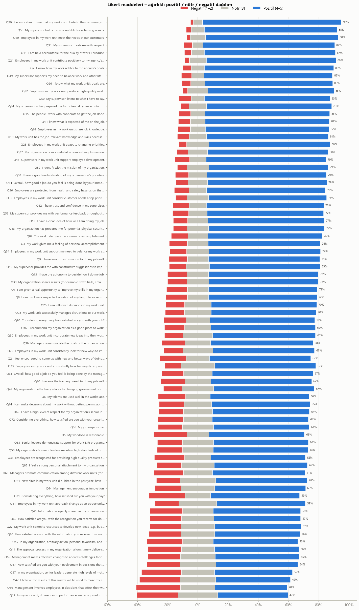
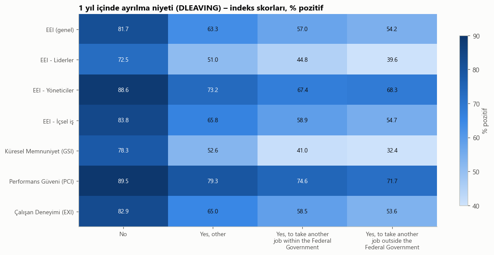

**Etiketin gruplara göre dağılımı:**

| Grup | Ayrılmayı düşünen (ağırlıklı) | Etki büyüklüğü (Cramér's V) |
|---|---|---|
| Engelli / değil | **%44,4** / %34,5 | 0,076 (en büyük, yine de küçük) |
| Kadın / erkek | %33,7 / %36,8 | 0,032 |
| Irk (Asian … Diğer) | %28,2 … %39,2 | 0,043 |
| Yönetici / değil | %36,0 / %36,9 | 0,003 |
| **Demografisi maskelenmiş olanlar** | **%42–45** | Boşluklar rastgele değil, bilgi taşıyor |

> **Ders:** 632 bin kişilik veride her fark "istatistiksel olarak anlamlı" çıkar (p < 0,05). Bu yüzden p-değerine değil, **etki büyüklüğüne** bakmak gerekir.

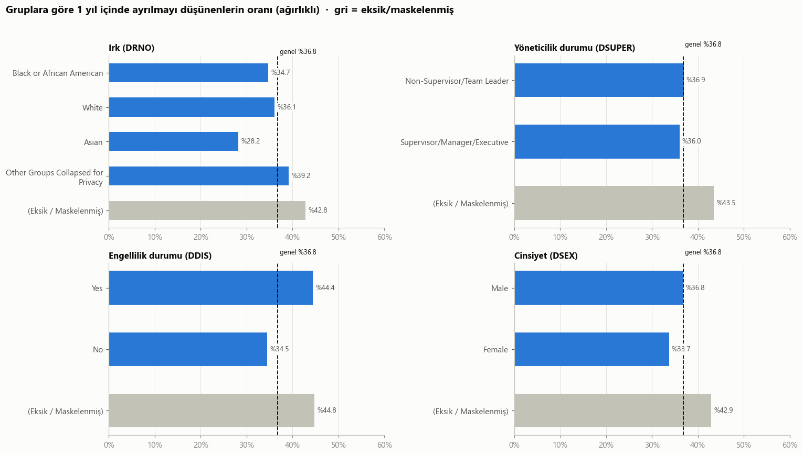

### 5.3 Hangi kurumlar benzer? (`03`)
Her kurumun 76 soruluk "cevap profili" çıkarıldı. Sadece genel moral seviyesi değil, **profil şekli** ("hangi konuda görece güçlü, hangisinde zayıf?") karşılaştırıldı. Hiyerarşik kümeleme ile **6 grup** bulundu:

| Küme | Kurumlar | Ortak özellik |
|---|---|---|
| **Savunma ve güvenlik** | Kara/Hava/Deniz Kuvvetleri, DoD, Adalet, İç Güvenlik | %38 sahada zorunlu çalışma, %40 askerlik geçmişi. **Ayrılma niyeti en yüksek (%41).** Army–Air Force benzerliği 0,91 |
| **Dış ilişkiler ve politika** | Dışişleri, USAID, OMB, EPA | Misyona bağlılık en yüksek. Amir geri bildirimi ve onay süreçleri zayıf (rotasyon, yurt dışı görevler) |
| **Düzenleyici kurullar** | CFTC, FTC, NLRB, Eğitim | Küçük kurumlar, %84 uzaktan çalışma. Ekip memnun, üst yönetime mesafe var |
| **Bilim ve doğal kaynak** | Tarım, İçişleri, Enerji, NSF, NRC, NARA, Ulaştırma | Özerklik yüksek, **üst yönetime güven düşük** |
| **Finans ve idari hizmet** | Hazine, GSA, SSA, Çalışma, Ticaret, PBGC, FERC, NCUA | Liderlik en iyi, ayrılma en düşük (%26). Hedefler net, ama iş "ilham verici" bulunmuyor |
| **Hizmet ve hak koruma** | Sağlık, EEOC, SBA, HUD, OPM, USAGM | İş ilham veriyor, ama özerklik ve söz hakkı düşük |

> Kümeleme kalitesi orta düzeyde (silhouette ≈ 0,2). Kurumlar keskin gruplara ayrılmıyor, bir yelpaze üzerinde duruyor. İnternetten derlenen ortak özellikler (GAO raporları, Best Places to Work sıralamaları vb.) notebook'un 7. bölümünde kaynaklarıyla birlikte verildi.

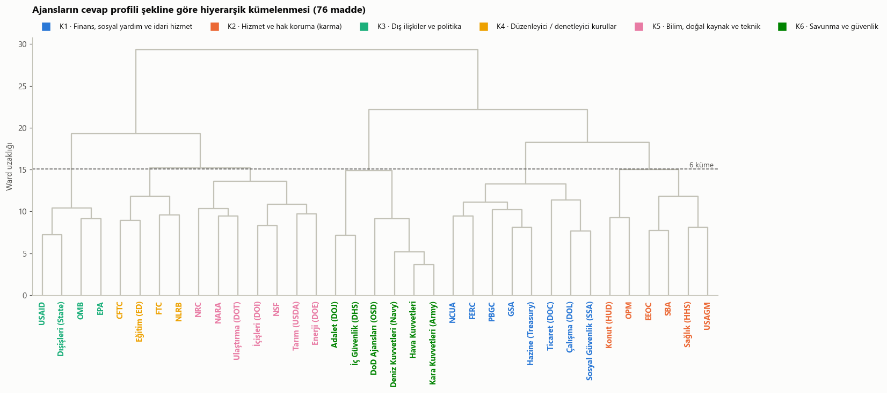
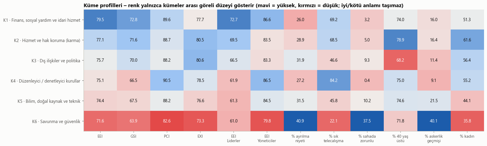

### 5.4 Her grubun kritik sorusu (`04`)
75 grup incelendi (36 kurum, 7 kurum kümesi, demografik kategoriler, genel grup). Her grup için en düşük puanlı, ayrılmayla en ilişkili ve "öncelikli" (ikisi birden) soru bulundu:

| Ölçüt | Kazanan soru | Kaç grupta 1. |
|---|---|---|
| En düşük puan | **Q17** – "Birimimde performans farkları anlamlı biçimde tanınıyor" | 37 / 75 |
| Ayrılmayla en ilişkili | **Q86** – "İşim bana ilham veriyor" | 39 / 75 |
| Öncelikli | **Q66** – "Yönetim, işimi etkileyen kararlara çalışanları dahil ediyor" | 36 / 75 |

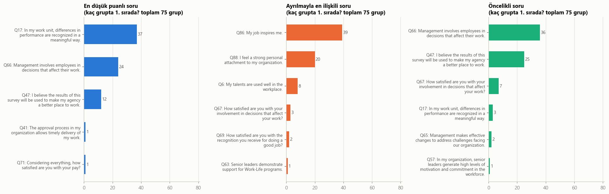

### 5.5 Ayrılmayı en çok etkileyen sorular (`05`)
Tek tek korelasyon yanıltıcı olabilir (benzer sorular aynı bilgiyi tekrarlar). Bu yüzden tüm soruları **aynı anda** gören iki model kuruldu: LightGBM + SHAP ve lojistik regresyon. **İkisi de aynı 5 soruyu buldu:**

| # | Soru | Türkçesi | En olumsuz → en olumlu cevapta ayrılma niyeti |
|---|---|---|---|
| 1 | Q88 | Kurumuma güçlü bir kişisel bağlılık hissediyorum | **%81 → %20** |
| 2 | Q86 | İşim bana ilham veriyor | %82 → %20 |
| 3 | Q71 | Maaşımdan memnunum | %69 → %21 |
| 4 | Q6 | Yeteneklerim iş yerinde iyi kullanılıyor | %77 → %20 |
| 5 | Q47 | Bu anketin sonuçlarının kurumu iyileştirmek için kullanılacağına inanıyorum | %68 → %19 |

> **Maaş (Q71) tek başına korelasyonda 28. sırada, ama modelde 3. sırada.** Yani maaş, diğer sorulardan **bağımsız** bir ayrılma nedeni. İşini seven biri bile maaştan memnun değilse ayrılmayı düşünebiliyor.

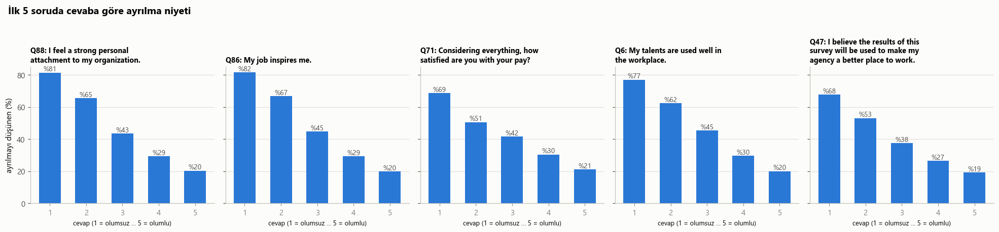

---

## 6. Tahmin modeli (`06`)

### 6.1 Yapay zekâ destekli kodlamanın bilinen risklerine karşı alınan önlemler

| Risk | Bu projede ne yapıldı? | Nerede kontrol edilir? |
|---|---|---|
| **Sessiz veri sızıntısı** | Eksik doldurma, ölçekleme ve one-hot **Pipeline içinde**, sadece eğitim verisine `fit`. Test seti **en başta** ayrıldı, ID'leri `data/test_ids.csv`'ye yazıldı, parmak izi (`08e7e1093d3d3350`) kaydedildi. Train ve test kesişmesi `assert` ile kontrol edildi | 06 – bölüm 3, 5 |
| **Zaman serisi hatası** | Veri tek yıllık kesitsel anket, zaman sırası yok. Rastgele **katmanlı** bölme uygun | 06 – bölüm 3 |
| **Hedef sızıntısı** | Q46/Q70/Q72 (genel memnuniyet = etiketin neredeyse eş anlamlısı) çıkarıldı. **Otomatik tarama:** tek başına AUC > 0,75 olan özellik yok (en yüksek: 0,696). Deney: bu 3 soru eklenseydi AUC 0,777 → **0,791** olurdu, yani model "neden ayrılıyor?" yerine "memnun mu?" sorusunu öğrenirdi | 06 – bölüm 4, 11 |
| **Yanlış sütunlar** | `RandomID` ve `POSTWT` özellik değil (`assert`). Ağırlık sadece `sample_weight` olarak kullanıldı | 06 – bölüm 2 |
| **Kategorik kodu sayı sanmak** | Kurum ve demografi kodları **one-hot**. Likert (1–5) sıralı olduğu için bilinçli olarak sayısal tutuldu | 06 – bölüm 2, 5 |
| **Hataları gizlemek** | `try/except` yok, uyarılar kapatılmadı. Her adımda satır sayısı yazdırılıyor. Silinen tek grup: etiketi boş 41.909 satır (%6,2), sayısı raporlandı | 06 – bölüm 1 |
| **Test setinde ayar yapmak** | Tuning, model seçimi ve eşik seçimi **sadece eğitim verisinde CV ile**. Test **bir kez**, en sonda kullanıldı | 06 – bölüm 6–10 |
| **Adaletsiz karşılaştırma** | Her modele **eşit bütçe:** aynı 60 bin satırlık örneklem, aynı 3 CV katı, 12'şer deneme, aynı metrik | 06 – bölüm 6 |
| **Abartılı başarı** | İki baseline: "herkese ortalama" (AUC 0,50) ve "tek soru kuralı" (0,695). Model 0,791. Ayrıca %95 güven aralıkları | 06 – bölüm 10 |
| **Rastgelelik** | `SEED = 42` her yerde | Tümü |
| **Eğitim–tahmin tutarsızlığı** | Özellik hazırlığı tek fonksiyonda (`hazirla`). Ön işleme + model tek Pipeline, `models/`'a kaydedildi. Geri yüklenip **birebir aynı tahmin** verdiği test edildi | 06 – bölüm 14 |
| **Gereksiz karmaşıklık** | Tek notebook, adım adım, her adım açıklamalı. Ek modül yok | — |
| **Kurallar** | `CLAUDE.md` dosyası bu kuralları yazılı hale getirir | Kök dizin |

### 6.2 Karşılaştırılan modeller ve sonuçlar

| Model | CV AUC (eğitim, ±SS) | **Test ROC-AUC** [%95 GA] | Test PR-AUC | Brier ↓ |
|---|---|---|---|---|
| Baseline: herkese ortalama | 0,500 | 0,500 | 0,369 | 0,233 |
| Baseline: tek soru (Q88) | 0,690 ± 0,005 | 0,695 [0,691–0,699] | 0,559 | 0,202 |
| Lojistik regresyon | 0,770 ± 0,004 | 0,780 [0,777–0,783] | 0,688 | 0,178 |
| Random Forest | 0,769 ± 0,003 | 0,783 [0,780–0,786] | 0,690 | 0,178 |
| **HistGradientBoosting** ✅ | 0,777 ± 0,003 | **0,791** [0,788–0,794] | 0,703 | **0,174** |
| LightGBM | **0,779** ± 0,004 | **0,791** [0,788–0,794] | 0,703 | **0,174** |

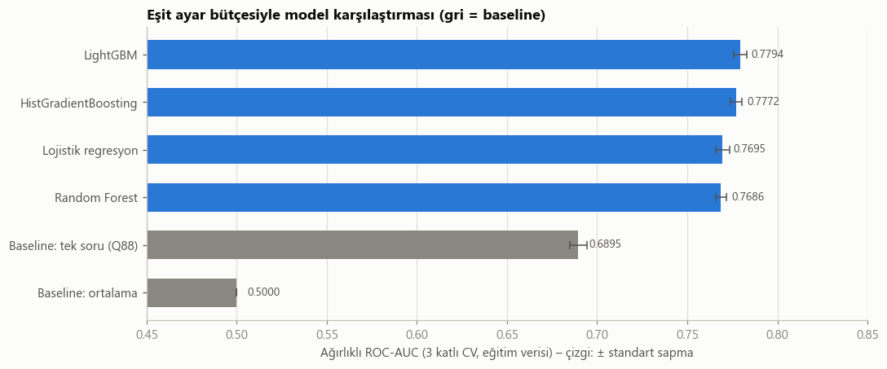

**Neden HistGradientBoosting?**
1. Seçim test setine bakılmadan, **CV sonuçlarıyla** yapıldı.
2. CV'de lider LightGBM (0,7794). HistGradientBoosting (0,7772) liderin **1 standart sapma** yakınında, yani aradaki fark istatistiksel olarak anlamsız.
3. **"Bir standart hata kuralı":** Fark anlamsızsa daha basit / daha az bağımlılıklı model seçilir. HistGradientBoosting scikit-learn'ün içinde, ek kütüphane gerektirmiyor.
4. Test seti bu kararı doğruladı: İki model testte **tamamen aynı** (0,791).

**Test AUC'si neden CV'den yüksek?** CV, zaman kazanmak için 60 bin satırlık örneklemde (her katta 40 bin satır eğitim) yapıldı. Final modeller ise 505 bin satırla eğitildi. Daha çok veri, daha iyi model. Bu bir sızıntı belirtisi değil: Bütün modellerde aynı yönde ve benzer büyüklükte bir artış var.

### 6.3 Karar eşiği ve hatalar
Eşik **eğitim verisinde** (out-of-fold tahminler, F1'i en yükseğe çıkaracak şekilde) **0,32** seçildi.

| Metrik (test) | Eşik 0,32 | Eşik 0,50 | Baseline: herkese "kalır" |
|---|---|---|---|
| Doğruluk | 0,708 | 0,745 | 0,631 |
| Kesinlik | 0,582 | 0,703 | – |
| **Duyarlılık** | **0,737** | 0,531 | 0 |
| F1 | **0,650** | 0,605 | 0 |

Okunuşu: Eşik 0,32'de model ayrılmayı düşünenlerin **%74'ünü yakalıyor**. "Ayrılacak" dediklerinin %58'i gerçekten ayrılmayı düşünüyor. Hangi eşiğin seçileceği amaca bağlı: kimseyi kaçırmamak mı önemli, yoksa az yanlış alarm mı?

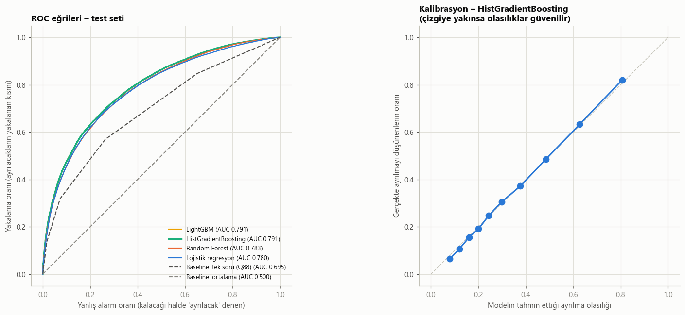
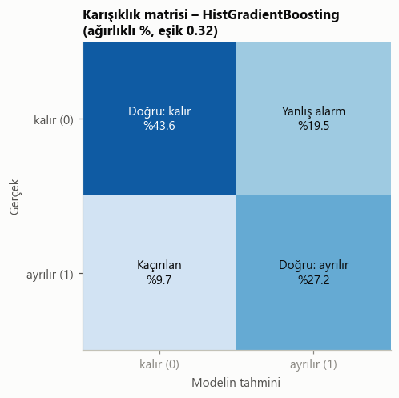

Kalibrasyon çizgisi köşegene çok yakın. Model "%40 ihtimal" dediğinde, o gruptakilerin gerçekten yaklaşık %40'ı ayrılmayı düşünüyor.

### 6.4 Model neye bakıyor? (permütasyon önemi)
İlk sıralar: **Q88 (bağlılık)**, **Q71 (maaş)**, **kurum**, **federal kıdem**, Q86 (ilham), Q6 (yetenek), Q63 (üst yönetimin iş-yaşam desteği), askerlik geçmişi, Q5 (iş yükü), tele-çalışma.

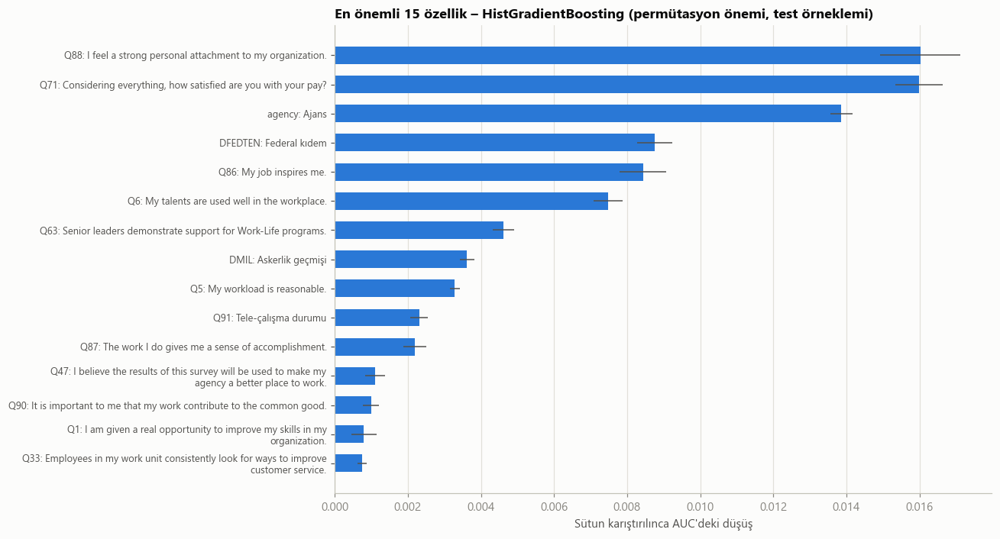

> Q47 (ankete güven) SHAP'te 5. sırada, permütasyonda 12. sırada. Sebebi: Permütasyon yönteminde birbirine benzeyen sorular önemi paylaşır. Bu yüzden iki yöntemin **ortak** bulgusuna güvenilmeli: Q88, Q86, Q71, Q6.

### 6.5 Bilinen uyarı
LightGBM 4.6 ile scikit-learn 1.8 birlikte kullanılınca `X does not have valid feature names` uyarısı çıkıyor. Bu, iki kütüphane arasındaki sütun adı kontrolüyle ilgili zararsız bir uyumsuzluk: Sütunlar aynı Pipeline içinde aynı sırayla üretildiği için tahminler etkilenmiyor. Kurallarımız gereği uyarı **kapatılmadı**, burada açıklandı.

---

## 7. Kuşak analizi

**Önemli sınırlama:** Veride doğum yılı yok. Gizlilik için yaş yalnızca **"40 altı / 40 ve üstü"** diye iki gruba indirilmiş. Anket 2024'te yapıldığı için:

| Grup | Doğum yılı (yaklaşık) | Kapsadığı kuşaklar |
|---|---|---|
| **Genç kuşak** (<40) | 1985 ve sonrası | Y kuşağının (1981–1996) büyük kısmı + Z kuşağı (1997–2012) |
| **Olgun kuşak** (40+) | 1984 ve öncesi | X kuşağı (1965–1980) + Baby Boomer (1946–1964) + Y'nin ilk yılları |

### 7.1 Ayrılma niyeti ve nedeni

| | Ayrılmayı düşünen | Başka federal işe | Federal sektör dışına | Diğer (emeklilik vb.) |
|---|---|---|---|---|
| **Genç kuşak** | **%38,6** | **%24,5** | **%6,5** | %7,6 |
| **Olgun kuşak** | %35,4 | %18,3 | %3,1 | **%14,0** |

Gençler daha çok **başka bir işe geçmek** için ayrılmayı düşünüyor. Federal sektör dışına geçme oranları olgun kuşağın iki katı. Olgun kuşakta "diğer" nedenler (muhtemelen emeklilik) iki kat daha sık.

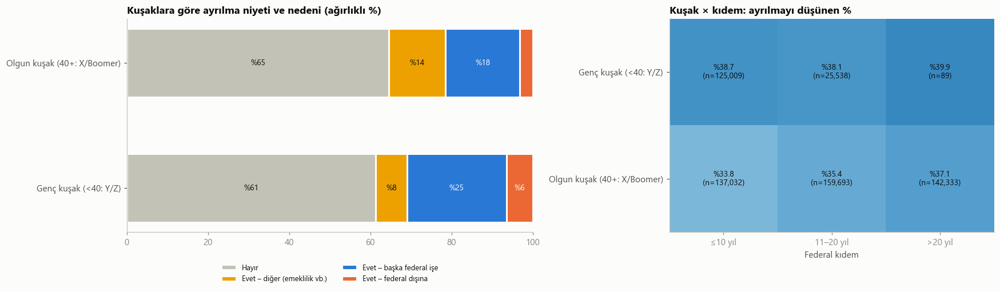

> Kuşak × kıdem tablosunda "genç ve 20 yıldan fazla kıdemli" hücresinde yalnızca 89 kişi var. Bu hücre güvenilir değil.

### 7.2 Model her iki kuşakta adil mi?

| | Test AUC | Gerçek ayrılma % | Modelin ortalama tahmini % | Duyarlılık |
|---|---|---|---|---|
| Genç kuşak | **0,817** | 38,8 | 38,5 | 0,785 |
| Olgun kuşak | 0,778 | 35,4 | 35,4 | 0,707 |

Tahminler iki kuşakta da **iyi kalibre** (gerçek oran ≈ tahmin). Model gençlerde daha iyi ayırt ediyor. Muhtemel neden: Olgun kuşakta emeklilik gibi anket sorularıyla ölçülmeyen nedenler daha fazla.

### 7.3 Kuşaklara göre en etkili sorular

| Sıra | Genç kuşak (<40) | Olgun kuşak (40+) |
|---|---|---|
| 1 | **Q71 – Maaş memnuniyeti** | **Q71 – Maaş memnuniyeti** |
| 2 | Q88 – Kuruma bağlılık | Kurum (hangi ajansta çalıştığı) |
| 3 | Kurum | **Federal kıdem** |
| 4 | Q86 – İşin ilham vermesi | Q88 – Kuruma bağlılık |
| 5 | Q6 – Yeteneklerin kullanılması | Q86 – İşin ilham vermesi |
| 6 | **Q63 – Üst yönetimin iş-yaşam dengesi desteği** | Q6 – Yeteneklerin kullanılması |

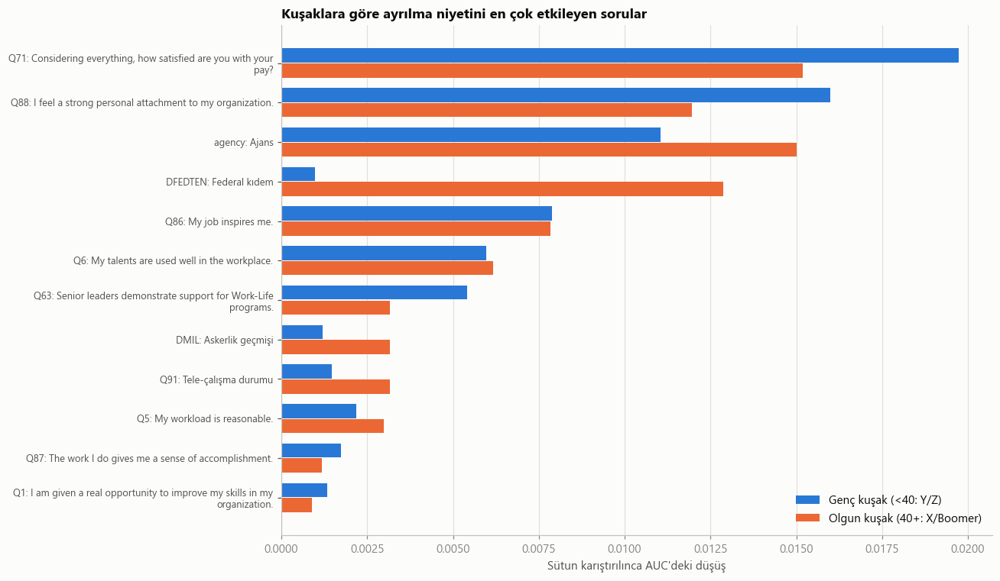

### 7.4 Kritik sorulara tepki
Gençler maaşa ve işin anlamına **daha keskin tepki veriyor:**
- Maaştan "hiç memnun değilim" diyen gençlerin %70'i ayrılmayı düşünüyor, "çok memnunum" diyenlerin %18'i. Olgunlarda bu %67 → %22.
- İşi ilham vermeyen gençlerin **%85'i** ayrılmayı düşünüyor (olgunlarda %79).

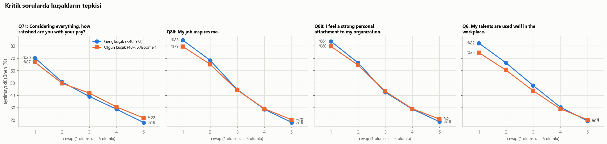

**Kuşak özeti:** Temel etkenler iki kuşakta **aynı** (maaş, aidiyet, anlam, yetenek). Fark, bu etkenlerin **gücünde**: Gençler daha hassas ve daha hareketli. Olgunlarda kariyer evresi (kıdem, emeklilik) öne çıkıyor. "Z kuşağı bambaşka" gibi kalıp yargılar yerine verinin söylediği şu: **Aynı şeyleri istiyorlar, ama karşılanmadığında gençler daha hızlı gidiyor.**

---

## 8. Sınırlılıklar
1. **Niyet ≠ davranış.** Etiket "ayrılmayı düşünüyorum" beyanı, gerçek işten ayrılma değil.
2. **İlişki ≠ neden.** "Maaşı artırırsak ayrılma azalır" demek için deneysel / nedensel analiz gerekir. Bulgularımız güçlü **ilişkiler**.
3. **Kuşak ayrımı kaba.** Yalnızca 40 yaş sınırı var.
4. **Maskeleme.** Demografinin %7–22'si gizlilik için silinmiş ve bu boşluklar rastgele değil.
5. **ABD kamu sektörü.** Sonuçlar özel sektöre ya da başka ülkelere doğrudan taşınamaz (bkz. bölüm 9).
6. **Yanıt oranı farkları.** Bazı kurumlarda yanıt oranı düşük (ör. Hava Kuvvetleri %18). Ağırlıklar bunu kısmen düzeltir.
7. **Tuning bütçesi.** Hız için 60 bin satırlık örneklem ve 12 deneme kullanıldı. Daha geniş bir arama sıralamayı değiştirmeyebilir, ama mutlak skorları biraz artırabilir.

---

## 9. Türkiye'deki çalışanlar için

### 9.1 Bu çalışma Türkiye'de nasıl yapılır? (adım adım)

| Adım | Ne yapılmalı? | Neden? |
|---|---|---|
| **1. Ölçeği uyarla** | FEVS soruları kamuya açık. **Çeviri – geri çeviri** yapın, küçük bir grupla pilot uygulayın, güvenirliği (Cronbach alfa) ve yapı geçerliğini (doğrulayıcı faktör analizi) test edin | "Katılıyorum" demeye eğilim ve kültürel anlam farkları sonuçları bozabilir |
| **2. Türkiye'ye özgü sorular ekle** | Enflasyon karşısında ücretin korunması, yan haklar (yemek, servis, özel sağlık sigortası), ulaşım süresi, hibrit çalışma, iş güvencesi, mobbing, terfi adaleti, eğitim–iş uyumu, **yurt dışında çalışma niyeti** | FEVS'teki "federal sektör dışına geçmek" seçeneğinin Türkiye'deki karşılığı "başka şirkete / yurt dışına" olabilir |
| **3. Anonimliği koru** | Raporlarda **en az 5 kişi** kuralı (FEVS'teki maskeleme gibi). Küçük birimleri birleştirin. Yaşı ve kıdemi kaba gruplarda sorun. Anketi bağımsız bir platformdan yapın | Çalışan, cevabının kendisine bağlanabileceğini düşünürse dürüst cevap vermez |
| **4. Ağırlıklandır** | İK kayıtlarındaki birim, cinsiyet ve yaş dağılımıyla cevaplayanları eşleştirin (OPM'nin "raking" yöntemi) | Ankete katılmayan gruplar sonuçta kaybolmasın |
| **5. Gerçek ayrılmayla birleştir** | Kişi bazında değil, **birim bazında** yapın: "Birimin anket skoru" ile "birimin sonraki yılki gerçek işten ayrılma oranı" | Anonimliği bozmadan niyet yerine gerçek davranışı ölçmenin yolu |
| **6. Bu repodaki analizleri uygula** | 02 (dağılımlar) → 03 (benzer birimler) → 04 (her birimin kritik sorusu) → 05/06 (ayrılmayı etkileyenler, kuşak) | Kod ve sızıntı önlemleri doğrudan kullanılabilir |

### 9.2 Hukuki çerçeve: KVKK (6698 sayılı Kişisel Verilerin Korunması Kanunu)
- **Anonim veri:** Anonim hale getirilmiş verinin araştırma, planlama ve istatistik amacıyla işlenmesi KVKK'nın kapsamı dışında tutulur (md. 28). Bu yüzden anketi **gerçekten anonim** tasarlamak hem en etik hem en güvenli yol.
- **Aydınlatma yükümlülüğü (md. 10):** Anketin amacını, verinin nasıl kullanılacağını ve kimlerin göreceğini açıkça yazın.
- **Özel nitelikli veri (md. 6):** Sağlık / engellilik, ırk / etnik köken, sendika üyeliği gibi bilgiler özel korumaya tabidir. Gerçekten gerekmiyorsa sormayın.
- **Otomatik karar (md. 11):** Kişinin, yalnızca otomatik sistemlerle yapılan analiz sonucunda aleyhine çıkan bir sonuca itiraz hakkı vardır. Bir modelin "ayrılma riski yüksek" dediği çalışana terfi vermemek ya da onu işten çıkarmak hem etik hem hukuki olarak sorunludur.
- İşveren–çalışan ilişkisindeki güç dengesizliği nedeniyle **açık rızanın "özgür irade" ile verildiği** her zaman tartışmalıdır. Mümkünse rızaya değil anonimliğe dayanın.

### 9.3 İşverenlerin dikkat etmesi gerekenler (bu analizin bulgularından)

| # | Bulgu (ABD verisi) | Türkiye'deki işveren için anlamı |
|---|---|---|
| 1 | **Aidiyet ve işin anlamı** (Q88, Q86) en güçlü etkenler | Çalışana işinin neye hizmet ettiğini gösterin. Rol tasarımı, misyon iletişimi ve takdir gibi parasal olmayan araçlar ayrılmayı en çok etkileyen alanlar |
| 2 | **Maaş bağımsız bir etken** (Q71). Gençlerde 1 numara | Yüksek enflasyon dönemlerinde ücret memnuniyetinin etkisi muhtemelen daha da güçlüdür. **Düzenli ve şeffaf ücret ayarlaması** yapın. "İşini seviyor, kalır" varsayımı yanlış |
| 3 | **Yeteneklerin kullanılması** (Q6). Gençler en çok başka bir işe geçmek için ayrılıyor | **Şirket içi hareketlilik** (iç ilanlar, rotasyon, proje bazlı görev) yoksa çalışan bu fırsatı dışarıda arar |
| 4 | **"Anket sonuçları kullanılacak mı?"** (Q47) en düşük puanlı sorulardan | Anket yapıp sonuçları paylaşmamak, hiç yapmamaktan daha zararlı olabilir. Sonuçları paylaşın, **2–3 somut aksiyon** ilan edin, bir sonraki ankette ne değiştiğini gösterin |
| 5 | **Performansın tanınması** (Q17) ve **karara katılım** (Q66) en zayıf alanlar | İyi performansın görünür biçimde ödüllendirilmesi ve çalışanı etkileyen kararlarda fikrinin sorulması düşük maliyetli ama etkili adımlar |
| 6 | Çalışanlar **birinci amire güveniyor, üst yönetime daha az** | Üst yönetim görünürlüğü (sahaya inmek, açık oturumlar) ve kararların gerekçesini anlatmak |
| 7 | **Sahada zorunlu çalışanlarda** moral belirgin şekilde düşük | Fabrika, mağaza, saha ekipleri: Uzaktan çalışma mümkün değilse vardiya seçimi, öngörülebilir planlama, ulaşım desteği gibi başka esneklikler sunun |
| 8 | Her kurum grubunun **zayıf noktası farklı** | Tek bir "çalışan bağlılığı programı" herkese uymaz. Birim bazında analiz yapıp birim bazında aksiyon alın |
| 9 | **Demografinin etkisi küçük**, koşulların etkisi büyük | Kadın, genç, engelli gibi grupları "riskli" diye etiketlemek yerine **koşulları** iyileştirin. Demografik profilleme ayrımcılık riski taşır |
| 10 | **Kuşaklar aynı şeyleri istiyor**, gençler daha hızlı gidiyor | Kuşak kalıp yargılarına değil veriye bakın. Gençler için ücret ve gelişim hızı, olgun kuşak için kariyer evresi ve emeklilik planlaması |
| 11 | Model iyi çalışıyor (AUC 0,79) | **Bireysel risk skoru üretmeyin.** Modeli "hangi koşullar ayrılmayı artırıyor?" sorusu için kullanın, "kim gidecek?" sorusu için değil. Aksi halde anket güveni bir daha geri gelmez |
| 12 | Niyet ≠ davranış | İşsizliğin yüksek olduğu dönemlerde ayrılmak isteyen ama ayrılamayan, **sessizce istifa etmiş** çalışan sayısı artabilir. Düşük ayrılma oranı her zaman yüksek bağlılık demek değildir |

---

## 10. Kaynaklar
- OPM – FEVS Public Release Data File: <https://www.opm.gov/fevs/public-data-file/>
- OPM – 2024 FEVS Technical Report (ağırlıklandırma, maskeleme, yanıt oranları)
- OPM – 2024 FEVS Governmentwide Management Report: <https://www.opm.gov/fevs/reports/governmentwide-reports/governmentwide-reports/governmentwide-management-report/2024/2024-governmentwide-management-report.pdf>
- Partnership for Public Service – 2024 Best Places to Work: <https://ourpublicservice.org/press-release/the-2024-best-places-to-work-in-the-federal-government-rankings-set-a-benchmark-for-the-trump-administration/>
- GAO – DHS Employee Morale (GAO-21-204): <https://www.gao.gov/assets/gao-21-204-highlights.pdf>
- DOJ OIG – Federal Hapishaneler Bürosu personel sorunu: <https://oig.justice.gov/tmpc/challenge-1>
- OPM – FY2024 Telework Report to Congress: <https://www.opm.gov/telework/history-legislation-reports/status-of-telework-in-the-federal-government-2025.pdf>
- 6698 sayılı Kişisel Verilerin Korunması Kanunu: <https://www.mevzuat.gov.tr/mevzuatmetin/1.5.6698.pdf>
- Kuşak tanımları (yaklaşık doğum yılları): Pew Research Center

> **Veri hakkında:** FEVS verisi ABD OPM tarafından kamuya açık olarak yayımlanmıştır. Bu repo veriyi içermez; `data/README.md`'deki adımlarla indirilebilir.
